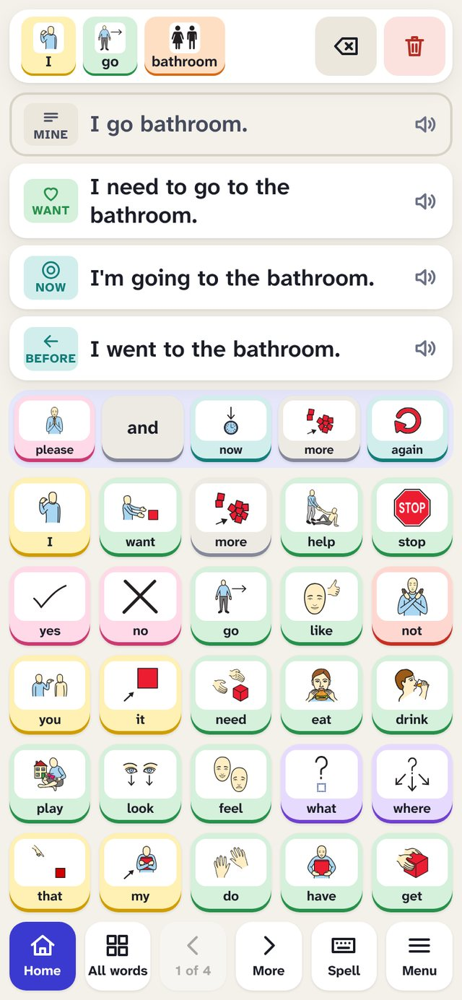
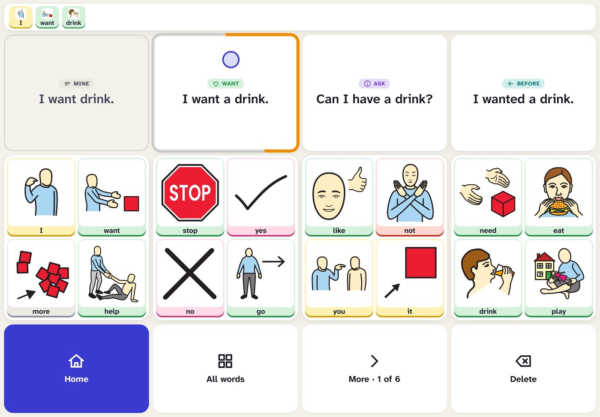
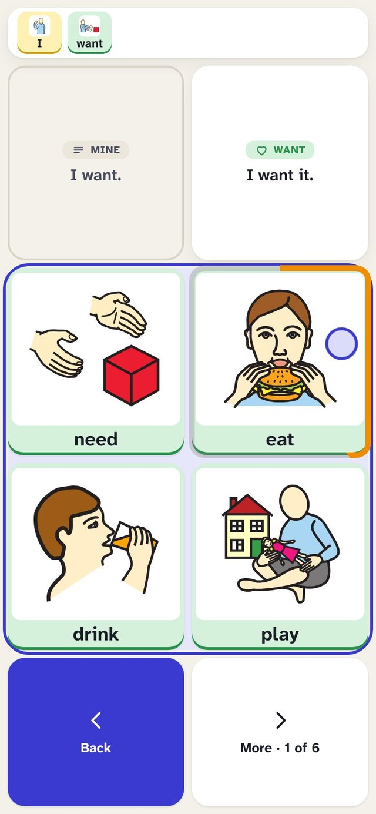

# Voice Before Words

A free communication board for people who cannot rely on speech. Choose
pictures, pick the sentence that says what you mean, and it is spoken aloud.

It runs in a web browser on a phone, tablet or computer. There is nothing to
buy, no account, and it keeps working without the internet once it has been
opened. It can be used by touch, by looking, by moving the head, with a single
switch, or with any pointing device.

<p>
  
  &nbsp;
  
</p>

*Left: touch, on a phone. Right: eye pointing, on a tablet. Every choice is
large, the ring shows what is about to be chosen, and words are chosen in two
looks: the group, then the word.*

> **Status: early.** Everything described here is built and passes its tests in
> a real browser. It has **not** yet been tried by the people it is for, or on a
> range of real phones and tablets, and it has not been clinically evaluated.
> See [What has and has not been verified](#what-has-and-has-not-been-verified).

## What it does

- **Symbols to sentences.** “I · go · bathroom” becomes *I need to go to the
  bathroom.*, *I'm going to the bathroom.* and *I went to the bathroom.* The
  person's exact words are always the first choice, nothing is ever spoken
  automatically, and each suggestion is labelled (want, now, before, ask…).
  This works on the device, instantly, with no internet.
- **A voice.** The chosen sentence is spoken with the best voice on the device.
  Speed, pitch and volume can be set, and names can be given a pronunciation.
- **834 words, 788 of them with a picture.** A core board ordered by
  usefulness, 19 category boards, a spelling board, colour coding by word type,
  and next-word prediction that learns from use. Positions never move, so they
  can be learned by habit. Families can add their own words, photos and quick
  phrases, and hide words they do not need.
- **Five ways to choose**, all ending in the same action a finger would make:

  | | Needs | What to expect |
  |---|---|---|
  | **Touch** | A finger, knuckle or stylus | The full board |
  | **Eyes** | The front camera | A few large targets. See [Can a web app do eye gaze?](#can-a-web-app-do-eye-gaze) |
  | **Head** | The front camera | Point with the nose. Usually steadier and finer than eyes |
  | **Scanning** | A blink, raised eyebrows, open mouth or smile seen by the camera; or a Bluetooth switch or key; or a tap anywhere | Choices light up in turn. Needs no pointing at all, so it reaches the full board |
  | **Pointer dwell** | A head mouse, trackball, or an eye tracker that moves the mouse pointer | Rest the pointer on something to choose it. The full board |

- **Smarter sentences with your own AI key (optional).** A settings page takes
  an API key for Claude, Gemini, OpenAI, or any OpenAI-compatible server
  (including a model running on your own computer). See
  [Using an AI model](#using-an-ai-model).
- **Private by design.** No server of ours exists. See [PRIVACY.md](PRIVACY.md).

## Try it

Needs [Node.js](https://nodejs.org) 20.19 or newer.

```bash
npm install
```

```bash
npm run dev
```

Then open the address it prints. To use the camera or to install it on a phone
it must be served over **https** (or from `localhost`); see
[Putting it online](#putting-it-online).

## Can a web app do eye gaze?

Yes, with limits that matter. This section is the honest version.

**What works.** A phone or tablet's ordinary front camera, with face-landmark
software running entirely on the device, can tell roughly where on the screen
someone is looking. Calibration takes about half a minute and needs no hands:
the dots start and advance by themselves.

**How accurate.** Measured on photographs of 56 people (details in
[docs/eye-tracking.md](docs/eye-tracking.md)), after a nine-dot calibration
with the head still:

| | |
|---|---|
| Typical error | 2.5° (about 2 cm on a tablet at 45 cm, 1.3 cm on a phone at 30 cm) |
| 9 looks in 10 land within | 4.4° |
| After the head turns 15° without recalibrating | 5.8° |
| A dedicated eye tracker, for comparison | about 0.5° to 1° |

That is good enough to tell **large areas** of the screen apart and not small
ones, so the app does not pretend otherwise:

- Targets for eye pointing are sized from each person's own calibration, at
  about 8° across. With that size a first look landed on the intended target
  **86 to 91%** of the time in the evaluation, and the person sees which target
  is about to be chosen for a second before it is.
- That means about **4 targets across on a tablet and 2 on a phone**. To keep a
  useful number of words in reach, words are chosen in **two looks**: a group
  of four, then the word. A page then holds 16 words on either device.

  
- The **head must stay roughly where it was** during calibration. The menu
  (reached by holding the eyes closed for two seconds, and worked by a face
  gesture so it needs no pointing) always offers "Calibrate again".
- **A tablet suits eye pointing much better than a phone.** On a phone, head
  pointing or scanning give more for less effort, and the app says so.

**What a browser cannot do.**

- It cannot open the camera or speak until someone has touched the screen or
  pressed a key **once** after the page opens. Someone has to do that at the
  start of each session; after it, everything is hands-free.
- It cannot match a dedicated eye tracker. If one is available, set it to move
  the mouse pointer and choose "Pointer dwell": the app then offers the full
  board.
- Face tracking needs a browser from 2023 or later (for example Safari 16.4).
  Older ones still get touch, scanning by switch, and pointer dwell.

## Using an AI model

The on-device sentence engine understands common patterns. A language model
understands far more of what someone means. In **Settings → Smart sentences**:

1. Choose a provider: **Claude**, **Gemini**, **OpenAI**, or **Other** (any
   server that speaks the OpenAI chat format, such as OpenRouter, or Ollama or
   LM Studio on your own computer).
2. Paste an API key and press **Test and turn on**.

What to know:

- **It is optional and off by default.** When it is on, the symbols in the
  message (and, if allowed, the last few sentences and the "About me" notes)
  are sent to the provider you chose. Nothing else is.
- **The key stays in this browser** and goes only to that provider. It is never
  included in backups. There is an option not to remember it between visits.
- **It never gets in the way.** On-device suggestions appear instantly and are
  replaced when the model answers. If it is slow, offline or refuses, they
  simply stay, with a short note saying why.
- **Cost is yours, and the model matters a great deal.** Each suggestion is a
  small request billed to your key. As a rough guide from list prices, someone
  who says a hundred sentences a day would spend a dollar or two a month with
  Claude Haiku 5.5, about $30 with Claude Sonnet 5.5 and about $60 with Claude
  Opus 5.5. Haiku is the default: it is fast and is plenty for most messages.
  The larger models are one tap away. Repeated messages are remembered on
  the device and not asked for twice, and the unchanging instructions are sent
  in a way that lets the provider bill them at a reduced rate.
- **The model is told to keep the person's meaning** and never to soften,
  censor or lecture: a communication aid that refuses to say what someone
  chose would take their voice away when it matters most. For Claude Opus 5.5
  and Sonnet 5.5, a request the model declines is automatically retried on
  another model by Anthropic's servers (the `fallbacks` option). Claude Haiku
  5.5 has no such retry; if it declines, the on-device suggestions stay.

## Privacy

Everything stays on the device unless an AI model is switched on. The camera
picture is analysed on the device and never recorded or sent. There is no
account, no analytics and no advertising. The full statement is in
[PRIVACY.md](PRIVACY.md).

## Browsers

| | Touch, scanning by switch, pointer dwell, speech | Camera (eyes, head, face gestures) |
|---|---|---|
| Chrome, Edge, Samsung Internet (Android, desktop) | Yes | Yes |
| Safari and every other browser on iPhone and iPad | Yes, iOS 15 or newer | iOS 16.4 or newer |
| Firefox | Yes | Yes |

Speech uses the voices installed on the device. Better voices can usually be
downloaded free in the device's own settings and then appear in the app.

## What has and has not been verified

Verified, by tests that run in a real browser against the production build:

- First run, composing messages, suggestions, speaking, every board and every
  settings page, in Chromium, Firefox and WebKit (the engine behind every
  browser on iPhone and iPad).
- Scanning with a switch, and choosing by resting a pointer, including that
  something which merely appears under a resting pointer is never chosen.
- The AI key flow against a stand-in for the provider: the request that is
  sent, suggestions arriving, repeats served from memory, and every failure
  falling back to on-device suggestions.
- The camera opening and the face tracker loading from the app's own files,
  with no request leaving the device, and the camera being restarted by the
  app when something takes it away.
- Working with no connection after one visit: the board, its pictures, its
  sentences, and eye pointing once it has been used (Chromium).
- Eye pointing end to end, by feeding photographs of real people looking in
  known directions into the app as its camera: hands-free calibration, the
  pointer landing about 2° from where the person was looking, and two-step
  choosing selecting what was aimed at.

Not yet verified:

- **Real devices and real people.** Accuracy figures come from still
  photographs taken in good light with the head on a chin rest. Everyday use,
  with a hand-held phone, changing light, glasses glare or involuntary
  movement, will be harder. Nobody who relies on AAC has tried this yet.
- **Head pointing and face gestures with a live face.** Their logic is tested
  with simulated measurements; they have not been tried on a person.
- **A real AI provider.** No API key was available during development, so the
  providers were tested against stand-ins that follow their documented formats.
- **iPhones, iPads and Android devices themselves**, as opposed to their
  browser engines on a desktop.

This is an aid, not a medical device. A speech and language therapist can help
choose and set up the right system for a person.

## Putting it online

`npm run build` writes a static site to `dist/`. Any static host will do
(Vercel, Netlify, Cloudflare Pages, GitHub Pages); `vercel.json` sets sensible
headers for Vercel. All paths are relative, so it also works from a sub-folder
or behind a rewrite.

Two things matter:

- **Use https.** Browsers only allow the camera on secure pages.
- **Give it its own address** (for example a subdomain) rather than a folder on
  a site that hosts other things. Browsers share storage between everything at
  one address, and this app may be holding someone's API key there.

## Working on it

```bash
npm run check
```

runs the type checker, the unit tests and a production build.

```bash
npm run test:e2e
```

runs the browser tests against the build (`npx playwright install chromium`
once beforehand; set `E2E_ALL=1` to include Firefox and WebKit).

| Folder | What is in it |
|---|---|
| `src/vocab/` | The words, their grammar, the boards, the picture index |
| `src/language/` | The on-device sentence engine and next-word prediction |
| `src/llm/` | The AI providers, the prompt, and the fallbacks |
| `src/speech/` | Choosing a voice and speaking |
| `src/access/` | Everything hands-free: face tracking, the gaze model, calibration, dwell, scanning, face gestures |
| `src/state/`, `src/views/`, `src/ui/`, `src/styles/` | The interface |
| `tests/`, `e2e/` | Unit tests and browser tests |
| `research/gaze/` | The scripts that fitted and evaluated the gaze model |
| `scripts/` | Building the symbol set and icons |

The symbols are rebuilt from their sources with
`npm run symbols -- --mulberry <folder> --otsimo <folder>`; which picture goes
with which word is in `scripts/symbol-sources.json`.

## Licences

The code is under the [MIT licence](LICENSE). The pictures are **not**: they
are from [Mulberry Symbols](https://mulberrysymbols.org) by Steve Lee and the
Otsimo symbol set, under Creative Commons BY-SA 4.0, which asks for credit and
for adaptations to be shared alike. [NOTICE.md](NOTICE.md) lists everything
this project builds on, including a note about the research data behind the
gaze model that matters if the project is ever used commercially.
